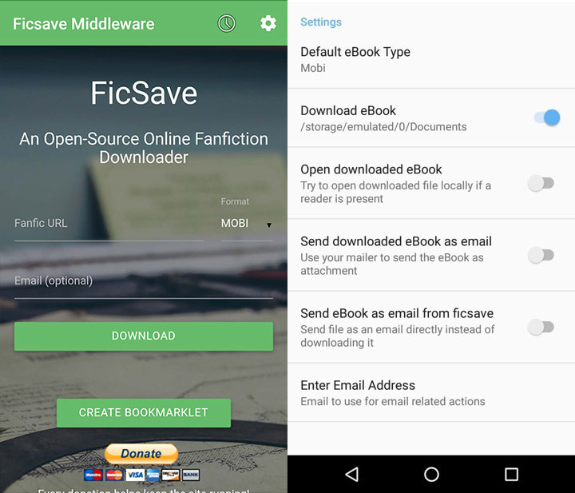

# FicHub Middleware (formerly Ficsave Middleware)

[](https://github.com/xRahul/FicsaveMiddleware/actions/workflows/ci.yml)
[](https://github.com/xRahul/FicsaveMiddleware/releases/latest)
[](https://github.com/xRahul/FicsaveMiddleware/blob/master/License.txt)

## What it does

This app is a WebView wrapper around [FicHub](https://fichub.net/), the successor to the now-defunct ficsave.xyz. Opening the website, entering the URL, and choosing options gets tedious after your 100th fic — this app automates the flow:

1. Share any fanfiction URL with the app.
2. The app loads `https://fichub.net/?b=1&q=<url>` and FicHub exports the story.
3. FicHub produces an EPUB/MOBI/PDF/Zipped HTML file which is downloaded via the Android DownloadManager into your `Documents/` folder.
4. You tap the download link (or the default-format auto-click handles it).

Current version: 3.0.0. Supports Android 7.0+ (minSdk 24), built against Android 16 (SDK 36).

## Features

* Share-intent auto-export: share a fic URL from any browser or app.
* Deep link support for `https://fichub.net`.
* Default eBook format preference: EPUB, MOBI, PDF, or Zipped HTML.
* Downloads land in `Documents/` via the system DownloadManager.
* Option to open the downloaded eBook automatically after download.
* Send the eBook as an email attachment directly from the device.
* Download history screen.
* Terms screen.
* In-app version check against GitHub releases.

## Supported sites

Per [fichub.net](https://fichub.net/):

* SpaceBattles, SufficientVelocity, QuestionableQuesting (XenForo)
* FanFiction.net
* FictionPress
* Archive Of Our Own (AO3)
* Harry Potter Fanfic Archive (HPFA)
* Sink Into Your Eyes (SIYE)
* AdultFanfiction.org
* Worm / Ward (+ partial list of other sites)

## Screenshots



## Build & Test

Requirements:

* JDK 17
* Android SDK 36

```sh
./gradlew assembleDebug
./gradlew testDebugUnitTest lintDebug
```

Note on package names: the applicationId remains `in.rahulja.ficsavemiddleware` so existing installs can update in place without losing data; the source code lives under the new package `in.rahulja.fichubmiddleware`.

## CI & Releases

GitHub Actions runs build + unit tests + lint on every push to `master` and on all pull requests (`.github/workflows/ci.yml`). Pushing a tag matching `v*` builds a signed APK and attaches it to a GitHub Release (`.github/workflows/release.yml`).

Signing requires these repository secrets:

| Secret | Purpose |
| --- | --- |
| `KEYSTORE_BASE64` | Base64-encoded keystore (decoded to `app/keystore.jks` by the workflow) |
| `SIGNING_STORE_PASSWORD` | Keystore password |
| `SIGNING_KEY_ALIAS` | Signing key alias |
| `SIGNING_KEY_PASSWORD` | Signing key password |

## Privacy

The app has no analytics and collects nothing. Story URLs you share are sent to fichub.net to generate the eBook; downloads are stored locally on your device.

## Credits

* Original ficsave.xyz app by [waylaidwanderer](https://github.com/waylaidwanderer).
* Export backend by [FicHub](https://github.com/FicHub/fichub.net).
* This app by [xRahul](https://github.com/xRahul).

Renaming this GitHub repository is an optional owner action; badges and links here assume the current slug `xRahul/FicsaveMiddleware`.

## License

[Apache License 2.0](License.txt)
